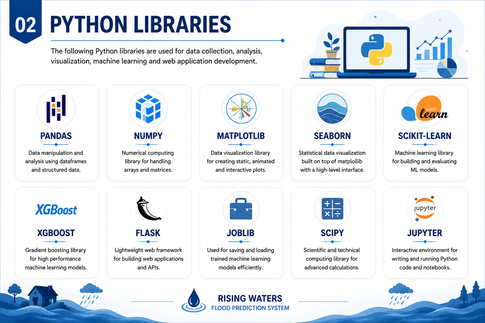
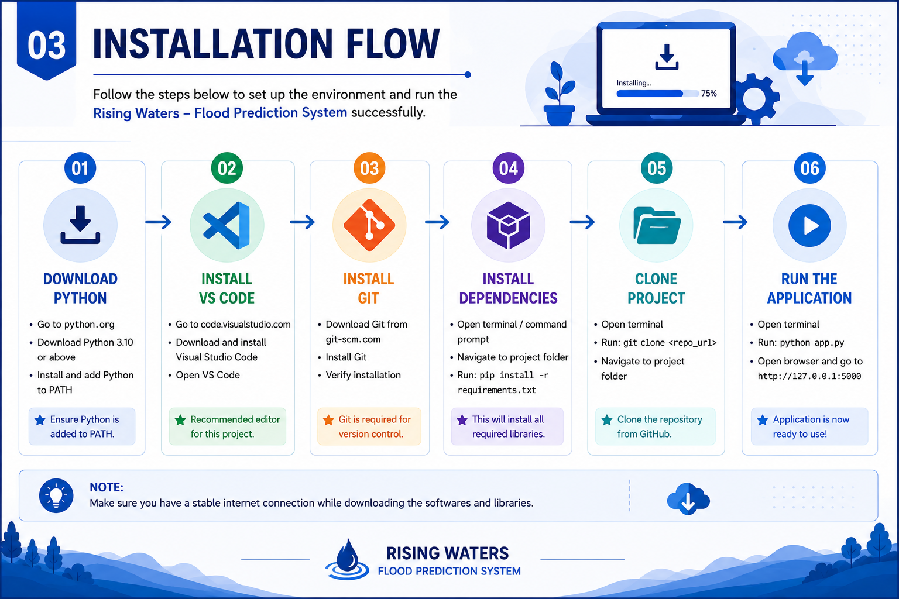

# ⚙️ Project Pre-requisites

This folder contains all the software, libraries, and setup requirements needed before running the **Rising Waters – Flood Prediction System**.

---

# 📂 Folder Contents

```
Pre_requisites/
│
├── images/
│   ├── 1_Software_requirements.png
│   ├── 2_Python_libraries.png
│   ├── 3_Installation_workflow.png
│   ├── 4_Project_folder_structure.png
│   └── 5_Flood_prediction_overview.png
│
├── requirements.txt
└── README.md
```

---

# 💻 Software Requirements

- Python 3.10+
- Visual Studio Code
- Git
- GitHub Account

---

# 📦 Python Libraries

- Pandas
- NumPy
- Matplotlib
- Seaborn
- Scikit-learn
- XGBoost
- Flask
- Joblib

---

# 🖼 Visual Guides

### Software Requirements


---

### Python Libraries



---

### Installation Workflow



---

### Project Folder Structure


---

### Flood Prediction Overview


---

# ✅ Outcome

After completing these prerequisites, the project environment is fully configured for data analysis, machine learning model development, and Flask web deployment.