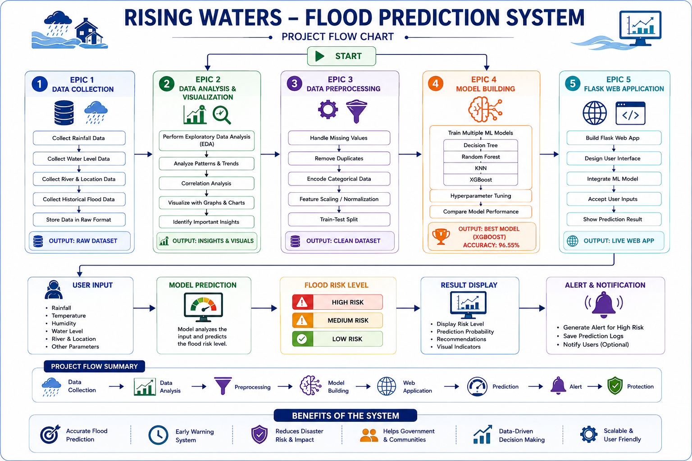
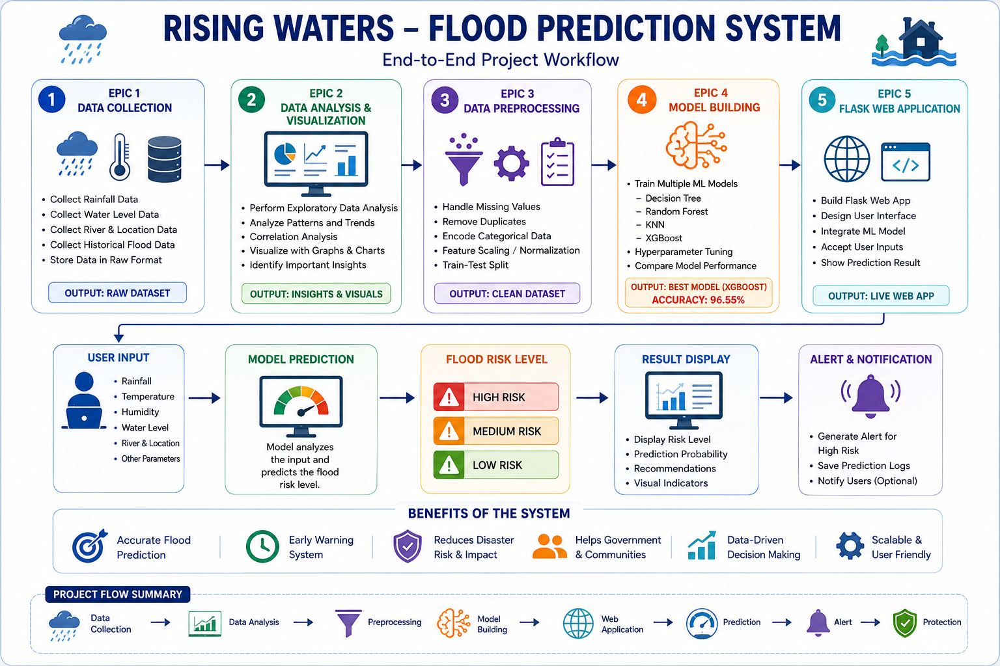

# 🔄 Project Workflow

This folder explains the complete workflow of the **Rising Waters – Flood Prediction System** from data collection to deployment.

---

# 📂 Folder Structure

```
Project_Flow/
│
├── Epic_Workflow.png
├── flow_chat.png
├── project_workflow.png
└── README.md
```

---

# 🌊 Complete Workflow

```
Start
   │
   ▼
Data Collection
   │
   ▼
Data Analysis
   │
   ▼
Data Preprocessing
   │
   ▼
Model Building
   │
   ▼
Model Evaluation
   │
   ▼
Flask Web Application
   │
   ▼
Flood Prediction
   │
   ▼
End
```

---

# 📊 Workflow Images

## Overall Project Workflow


---

## Flow Chart



---

## Detailed Workflow



---

# 🚀 Summary

The workflow demonstrates the end-to-end lifecycle of the project, beginning with data collection and ending with real-time flood prediction through a Flask web application.